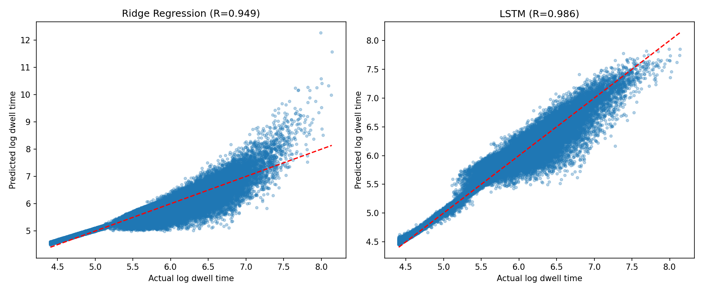
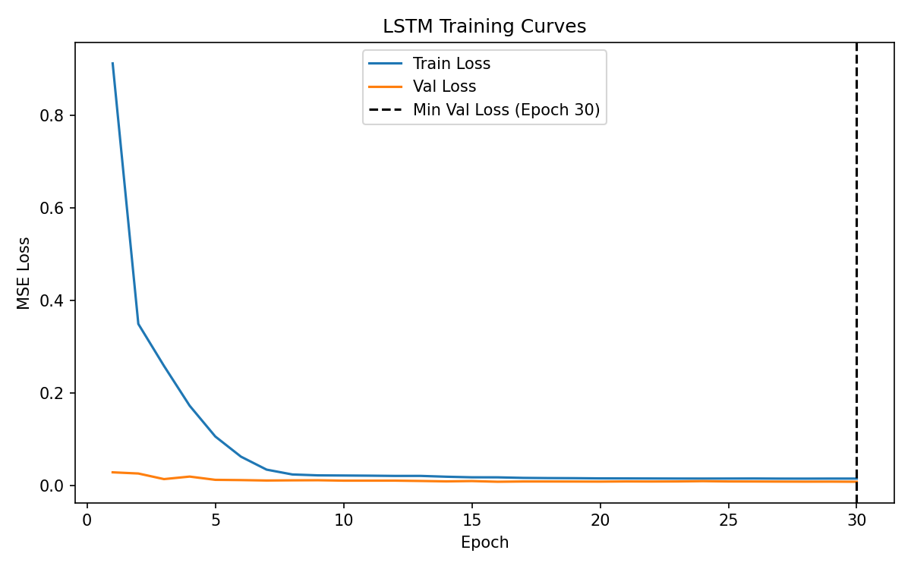
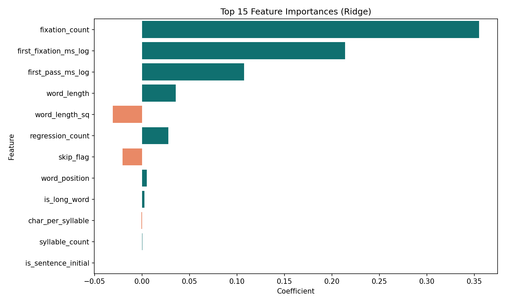
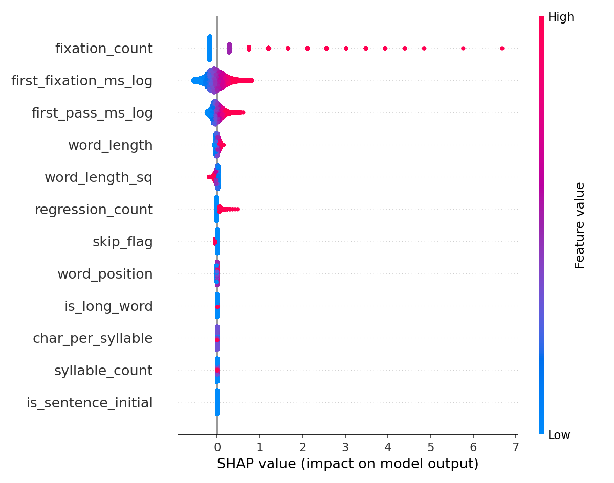

# EyeTrackit — Real-Time Reading Difficulty & Cognitive Load Prediction


**EyeTrackit** is an end-to-end Artificial Intelligence and Deep Learning system that predicts word-level reading difficulty (cognitive load) by combining eye-movement dynamics with psycholinguistic features.

The system bridges offline sequential deep learning and real-time browser-based computer vision through two tightly integrated components:
1. **Offline ML/DL Training & Explainability Pipeline:** Fetches and processes the **Provo Eye-Tracking Corpus**, engineers 12 gaze, linguistic, and positional features, benchmarks an L2-regularized **Ridge Regression** baseline against a **2-layer PyTorch LSTM** sequence model, and generates **SHAP** explainability diagnostics.
2. **Real-Time Webcam Eye-Tracking Web Application (`EyeTrack ML`):** Uses **WebGazer.js** inside a **React 19 + Vite** interface to track live webcam gaze fixations, saccades, and regressions across custom passages, querying a **FastAPI** inference engine to render an interactive word-by-word cognitive load heatmap.

---

## Table of Contents
- [Overview & Motivation](#overview--motivation)
- [System Architecture](#system-architecture)
- [Repository Structure](#repository-structure)
- [Dataset & Feature Engineering](#dataset--feature-engineering)
- [Model Architectures](#model-architectures)
- [Experimental Results & Visual Diagnostics](#experimental-results--visual-diagnostics)
- [Live Web Application Walkthrough](#live-web-application-walkthrough)
- [REST API Specification](#rest-api-specification)
- [Installation & Setup](#installation--setup)
- [Limitations & Future Scope](#limitations--future-scope)
- [Author & Academic Information](#author--academic-information)

---

## Overview & Motivation

Human reading is not a smooth, linear scan; instead, the eyes move in rapid jumps (**saccades**) separated by brief pauses (**fixations**) and backward re-readings (**regressions**). When a reader encounters unfamiliar vocabulary, complex syntax, or high conceptual density, fixation duration and regression frequency increase measurably—making **total word dwell time** an objective behavioral proxy for cognitive load.

Traditional eye-tracking studies rely on expensive infrared hardware (e.g., EyeLink trackers) restricted to laboratory environments. **EyeTrackit** demonstrates that models trained on high-precision corpus data (**Provo Corpus**) can be paired with standard consumer webcams via **WebGazer.js** to estimate word-level reading difficulty in real time.

---

## System Architecture

```text
┌──────────────────────────────────────────────────────────────────────────────┐
│                 TIER 1: OFFLINE ML/DL PIPELINE (Provo Corpus)                │
│                                                                              │
│  OSF API (Provo CSV) ──► data_loader.py ──► data/processed/dataset.csv       │
│                                                  │                           │
│                                                  ▼                           │
│  preprocessor.pkl ◄── feature_engineer.py (12 Gaze + Linguistic Features)    │
│         │                                        │                           │
│         ▼                                        ▼                           │
│  ridge_model.pkl (RidgeCV)              lstm_best.pt (2-Layer PyTorch LSTM)  │
│         │                                        │                           │
│         └───────────────────┬────────────────────┘                           │
│                             ▼                                                │
│       evaluator.py ──► metrics.csv, SHAP & Training Plots, final_report.md   │
└──────────────────────────────────────────────────────────────────────────────┘

┌──────────────────────────────────────────────────────────────────────────────┐
│              TIER 2: REAL-TIME WEBCAM INFERENCE WEB APPLICATION               │
│                                                                              │
│  Webcam Feed ──► WebGazer.js (9-Point Calibration + Ridge Gaze Estimator)    │
│                       │                                                      │
│                       ▼                                                      │
│  ReadingGame.jsx (Word Bounding-Box Hit Testing, Fixations & Regressions)    │
│                       │                                                      │
│                       ▼  POST /predict (JSON Payload)                        │
│  FastAPI (backend/app.py) ──► preprocessor.pkl + ridge_model.pkl + Fallback  │
│                       │                                                      │
│                       ├──► Logs telemetry to data/processed/live_webcam_data.csv
│                       ▼                                                      │
│  Percentile-Based Color-Coded Heatmap (Easy / Medium / Hard / Very Hard)     │
└──────────────────────────────────────────────────────────────────────────────┘
```

---

## Repository Structure

```text
EyeTrackit/
├── backend/
│   ├── app.py                          # FastAPI inference server, fallback heuristics & CSV logger
│   └── requirements.txt                # Backend Python dependencies
├── data/
│   ├── raw/
│   │   └── provo/
│   │       └── Provo_Corpus-Eyetracking_Data.csv
│   └── processed/
│       ├── dataset.csv                 # Cleaned Provo Corpus training dataset
│       └── live_webcam_data.csv        # Continuously logged telemetry from live webcam sessions
├── docs/
│   └── screenshots/                    # Live web application UI screenshots
├── features/
│   └── feature_names.txt               # Ordered list of the 12 engineered features
├── frontend/
│   ├── public/                         # Static SVG icons and assets
│   ├── src/
│   │   ├── App.jsx                     # Workflow controller (Calibrate -> Passage Input -> Read)
│   │   ├── App.css                     # Component styling
│   │   ├── index.css                   # Dark glassmorphism theme variables
│   │   ├── main.jsx                    # React 19 entry point
│   │   ├── ReadingGame.jsx             # Gaze-to-word hit detection & difficulty heatmap renderer
│   │   └── WebGazerProvider.jsx        # WebGazer.js lifecycle & 9-point screen calibration
│   ├── index.html
│   ├── package.json
│   └── vite.config.js
├── models/
│   ├── lstm_best.pt                    # Best PyTorch LSTM model weights
│   ├── preprocessor.pkl                # Fitted SimpleImputer + StandardScaler pipeline
│   └── ridge_model.pkl                 # Trained 5-fold cross-validated RidgeCV model
├── notebooks/                          # Exploratory data analysis notebooks
├── results/
│   ├── actual_vs_predicted.png         # Ridge vs. LSTM scatter comparison
│   ├── final_report.md                 # Auto-generated quantitative summary report
│   ├── lstm_loss_history.csv           # Epoch-by-epoch train/validation MSE loss
│   ├── lstm_training_curves.png        # Learning curves over 30 training epochs
│   ├── metrics.csv                     # Evaluation metrics table (RMSE, Pearson R, R2)
│   ├── ridge_feature_importance.png    # Ranked Ridge regression coefficients
│   └── shap_summary.png                # SHAP beeswarm feature impact plot
├── src/
│   ├── data_loader.py                  # OSF API fetcher & Provo Corpus preprocessor
│   ├── evaluator.py                    # Metric calculation, plots & SHAP explainability
│   ├── feature_engineer.py             # 12-feature extraction & standardization pipeline
│   ├── model_trainer.py                # RidgeCV and PyTorch LSTM training routines
│   └── utils.py                        # Logger setup, project root resolver & deterministic seeding
├── requirements.txt                    # Core offline ML/DL pipeline dependencies
└── run_pipeline.bat                    # One-click Windows batch execution script
```

---

## Dataset & Feature Engineering

### 1. Provo Eye-Tracking Corpus
`src/data_loader.py` queries the Open Science Framework (OSF node `sjefs`) via REST API to automatically download `Provo_Corpus-Eyetracking_Data.csv`. It extracts 11 core eye-tracking and lexical fields (`Text_ID`, `Word_Number`, `Word`, `IA_FIRST_FIXATION_DURATION`, `IA_DWELL_TIME`, `IA_REGRESSION_IN_COUNT`, `IA_SKIP`, `IA_FIRST_RUN_DWELL_TIME`, `IA_FIXATION_COUNT`, `Syllable_Count`, `Word_Length`), drops records with missing initial fixation durations, and writes the cleaned dataset to `data/processed/dataset.csv`.

### 2. Target Variable Formulation
Because raw human fixation durations exhibit heavy right-skewness, total eye dwell time (`IA_DWELL_TIME` / `total_fixation_ms`) is modeled in log-transformed space:

$$y = \log(1 + \text{total\_fixation\_ms})$$

During evaluation and live inference, predicted values $\hat{y}$ are mapped back to milliseconds via:

$$\hat{t}_{\text{ms}} = \exp(\hat{y}) - 1$$

### 3. Engineered Features (`12 Features`)
`src/feature_engineer.py` constructs 12 features organized into three psycholinguistic groups, followed by median imputation (`SimpleImputer`) and z-score standardization (`StandardScaler`) serialized to `models/preprocessor.pkl`:

| Feature Group | Feature Name | Mathematical / Domain Definition |
| :--- | :--- | :--- |
| **Eye-Movement (5)** | `first_fixation_ms_log` | Log duration of the initial fixation on a word: $\log(1 + t_{\text{first}})$ |
| | `first_pass_ms_log` | Log first-run gaze duration before exiting the word: $\log(1 + t_{\text{first\_pass}})$ |
| | `fixation_count` | Total number of fixations recorded on the target word |
| | `regression_count` | Number of backward eye movements (re-readings) into the word |
| | `skip_flag` | Binary indicator (`1` if word was skipped on first pass, `0` otherwise) |
| **Linguistic (5)** | `word_length` | Character count of the target word ($L$) |
| | `syllable_count` | Number of syllables ($S$, corpus value or vowel-cluster regex estimator) |
| | `word_length_sq` | Quadratic character length ($L^2$) capturing non-linear length penalties |
| | `char_per_syllable` | Orthographic density ratio: $L / (S + 10^{-5})$ |
| | `is_long_word` | Binary indicator (`1` if $L > 8$, `0` otherwise) |
| **Contextual (2)** | `word_position` | Min-max normalized word index within each passage (`text_id`) |
| | `is_sentence_initial` | Binary indicator for the opening word of a passage (`word_id == 1`) |

---

## Model Architectures

### 1. Ridge Regression Baseline (`RidgeCV`)
- **Objective:** Minimizes L2-penalized residual sum of squares $\min_w \Vert{}Xw - y\Vert{}_2^2 + \alpha \Vert{}w\Vert{}_2^2$.
- **Hyperparameter Search:** 5-fold cross-validation (`neg_mean_squared_error`) across $\alpha \in \{0.01, 0.1, 1, 10, 100, 1000\}$.
- **Production Role:** Provides an interpretable linear baseline and serves real-time predictions in `backend/app.py` with sub-millisecond latency.

### 2. Deep Learning Sequence Model (`LSTMDifficultyNet`)
In natural reading, cognitive processing of one word frequently spills over onto subsequent words. To capture sequential context, `src/model_trainer.py` constructs sliding windows of **`seq_len = 10`** consecutive words (`input tensor shape: (batch, 10, 12)`):

- **Recurrent Backbone:** 2-layer `nn.LSTM` (`input_size=12`, `hidden_size=64`, `num_layers=2`, `dropout=0.3`, `batch_first=True`)
- **Regression Head:** Final time-step hidden state $h_T \rightarrow$ `Linear(64, 32)` $\rightarrow$ `ReLU` $\rightarrow$ `Dropout(0.2)` $\rightarrow$ `Linear(32, 1)`
- **Training Configuration:** Trained for `30` epochs using `Adam` (`lr=0.001`, `weight_decay=1e-4`), `MSELoss`, batch size `64`, and an 80/20 train-validation split (`random_state=42`).

---

## Experimental Results & Visual Diagnostics

### Quantitative Benchmark (`results/metrics.csv`)

| Model | $\text{RMSE}_{\log}$ | $\text{RMSE}_{\text{ms}}$ | Pearson $R$ | $R^2$ Score |
| :--- | :---: | :---: | :---: | :---: |
| **Ridge Regression (`RidgeCV`)** | `0.1650` | `673.35 ms` | `0.9489` | `0.9005` |
| **PyTorch LSTM (`LSTMDifficultyNet`)** | **`0.0880`** | **`52.16 ms`** | **`0.9858`** | **`0.9717`** |

### Key Analytical Insights
1. **92.3% Reduction in Millisecond Error:** Modeling 10-word sequential reading context allows the LSTM to cut real-world dwell-time error from **673.35 ms** down to **52.16 ms** while increasing explained variance ($R^2$) from **0.9005** to **0.9717**.
2. **Elimination of Right-Tail Blowup:** As illustrated in the Actual vs. Predicted scatter comparison below, linear extrapolation in Ridge overestimates extreme log dwell times ($\hat{y} > 10$), which explodes exponentially when transformed back via $\exp(\hat{y}) - 1$. The LSTM constrains extreme predictions tightly along the identity diagonal.
3. **Feature Attribution & Explainability:** Both Ridge coefficients and SHAP beeswarm distributions confirm that `fixation_count`, `first_fixation_ms_log`, and `first_pass_ms_log` are the strongest positive drivers of dwell time, followed by `word_length` and `regression_count`, whereas `skip_flag` and `word_length_sq` exert negative weights.

### Model Evaluation & SHAP Plots (`results/`)

| Actual vs. Predicted Dwell Time | LSTM Training & Validation Loss |
| :---: | :---: |
|  |  |

| Ridge Feature Importances | SHAP Summary Beeswarm Plot |
| :---: | :---: |
|  |  |

---

## Live Web Application Walkthrough

The interactive frontend (`EyeTrack ML`) guides the user through a four-stage real-time reading session:

1. **9-Point Screen Calibration (`WebGazerProvider.jsx`):** Initializes `window.webgazer` using its built-in ridge gaze estimator. The user clicks 9 locations across screen corners, edges, and center while fixating on the cursor.
2. **Passage Configuration (`App.jsx`):** Once calibrated, the webcam preview automatically hides to prevent visual distraction, and the user can read the default passage or paste custom text.
3. **Live Gaze-to-Word Tracking (`ReadingGame.jsx`):** Listens to custom `gazeData` events `(x, y, time)` and maps gaze coordinates against rendered word DOM bounding boxes (`20px` spatial padding tolerance) to record `first_fixation_ms`, `first_pass_ms`, `fixation_count`, `regression_count`, and `skip_flag`.
4. **Adaptive Percentile Difficulty Heatmap:** Clicking **Finish Reading** queries `POST /predict` and color-codes every word by session percentile with interactive millisecond tooltips (`e.g., 274ms`):
   - **Easy (`≤ 60th percentile`):** Green (`#4ade80`)
   - **Medium (`60th – 80th percentile`):** Yellow (`#facc15`)
   - **Hard (`80th – 95th percentile`):** Orange (`#fb923c`)
   - **Very Hard (`> 95th percentile`):** Red (`#f87171`)

| 1. 9-Point Eye Tracker Calibration | 2. Calibration Complete & Passage Input |
| :---: | :---: |
|  |  |

| 3. Active Gaze-Tracked Reading Session | 4. Word-Level Cognitive Load Heatmap |
| :---: | :---: |
|  |  |

---

## REST API Specification

`backend/app.py` exposes a FastAPI inference endpoint at `http://localhost:8000/predict`. To guarantee robust predictions even when low-FPS webcam tracking skips short words, the endpoint combines ML inference with domain heuristics:
- **Baseline Gaze Imputation:** Zero/untracked `first_fixation_ms` and `first_pass_ms` values are imputed to `200.0 ms` prior to feature scaling (`preprocessor.transform(X)`).
- **Linguistic Fallback Heuristic:** For words missed by the webcam tracker (`first_fixation_ms <= 0`), a psycholinguistic baseline $t_{\text{heur}} = 180.0 + 12.0 \cdot L + 5.0 \cdot S$ is blended (`max(predicted_ms, heuristic_ms)`) and floored at `150.0 ms`.
- **Continual Telemetry Logging:** Every session payload is appended to `data/processed/live_webcam_data.csv` for future model fine-tuning.

### `POST /predict`

**Request Body:**
```json
{
  "session_id": "session-2026-01",
  "words": [
    {
      "word": "cognitive",
      "word_id": 1,
      "first_fixation_ms": 245.0,
      "first_pass_ms": 310.0,
      "fixation_count": 2,
      "regression_count": 1,
      "skip_flag": 0
    }
  ]
}
```

**Response Body:**
```json
{
  "session_id": "session-2026-01",
  "results": [
    {
      "word_id": 1,
      "word": "cognitive",
      "predicted_difficulty_ms": 384.62
    }
  ]
}
```

---

## Installation & Setup

### Prerequisites
- **Python** 3.10+
- **Node.js** 18+ and **npm**
- **Webcam** with browser camera permissions enabled

### 1. Clone the Repository
```bash
git clone [https://github.com/AADIL-4U/EyeTrackit.git](https://github.com/AADIL-4U/EyeTrackit.git)
cd EyeTrackit
```

### 2. Run the Offline ML/DL Training Pipeline
Install core pipeline dependencies:
```bash
pip install -r requirements.txt
```

**Option A — One-Click Execution (Windows):**
```cmd
run_pipeline.bat
```

**Option B — Step-by-Step Execution (Windows / macOS / Linux):**
```bash
python src/data_loader.py       # Downloads & cleans Provo Corpus -> data/processed/dataset.csv
python src/feature_engineer.py  # Extracts 12 features & saves models/preprocessor.pkl
python src/model_trainer.py     # Trains RidgeCV & PyTorch LSTM -> models/
python src/evaluator.py         # Generates metrics.csv, 4 plots & final_report.md
```

### 3. Launch the FastAPI Backend
Open a terminal in the project root:
```bash
cd backend
pip install -r requirements.txt
uvicorn app:app --reload --host 0.0.0.0 --port 8000
```

### 4. Launch the React + Vite Frontend
Open a second terminal in the project root:
```bash
cd frontend
npm install
npm run dev
```
Navigate to `http://localhost:5173` in your browser, grant camera permissions, complete the 9-point calibration, and click **Start Reading**.

---

## Limitations & Future Scope

- **Head-Pose Drift in Webcam Tracking:** Unlike stationary infrared eye trackers, webcam gaze accuracy degrades if the user shifts posture significantly after initial calibration. Adding periodic mid-passage anchor checkpoints will mitigate spatial drift.
- **Sequence-Aware Live Inference:** Currently, `backend/app.py` serves `ridge_model.pkl` for single-pass low-latency inference. Integrating a 10-word sliding-window buffer will enable live inference using `lstm_best.pt`.
- **Continual Learning Pipeline:** Periodically retraining on accumulated webcam telemetry stored in `data/processed/live_webcam_data.csv` will adapt the model to browser-based gaze distributions.

---

## Author & Academic Information

- **Name:** Mohd Aadil Ashraf
- **Roll Number:** `2403A51315`
- **Batch:** `13 CSE`
- **Course:** B.Tech in Computer Science and Engineering (III Year, I Semester)
- **Subject:** Artificial Intelligence and Deep Learning
- **Institution:** School of Computer Science & Artificial Intelligence, SR University, Warangal, Telangana, India
- **Repository:** [https://github.com/AADIL-4U/EyeTrackit](https://github.com/AADIL-4U/EyeTrackit)